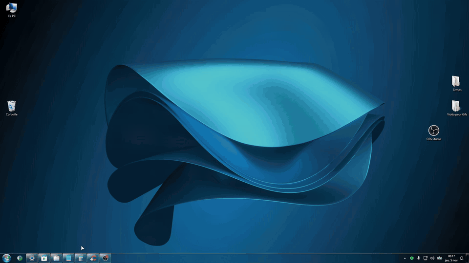
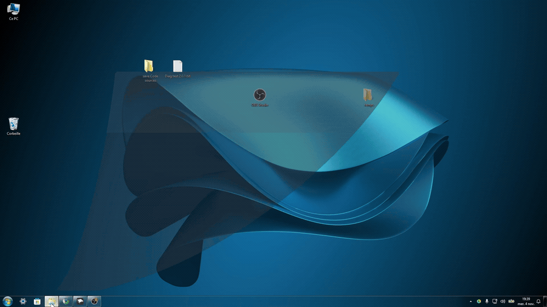
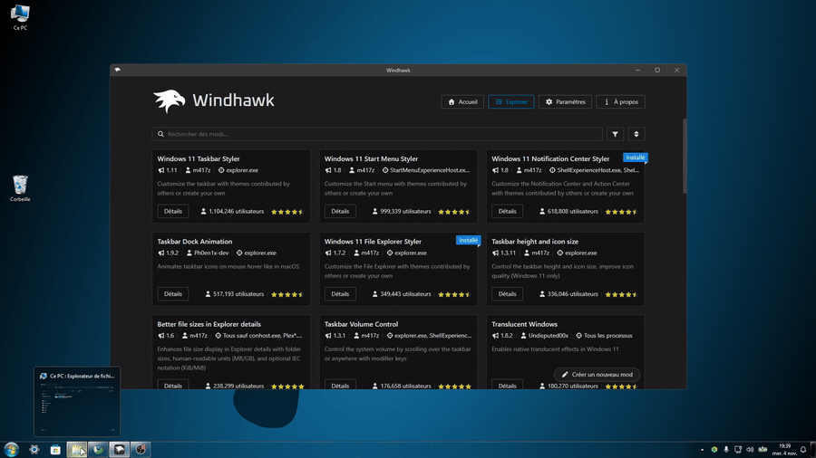
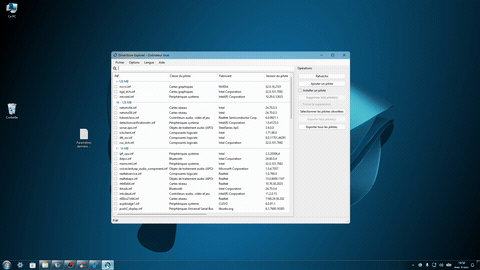
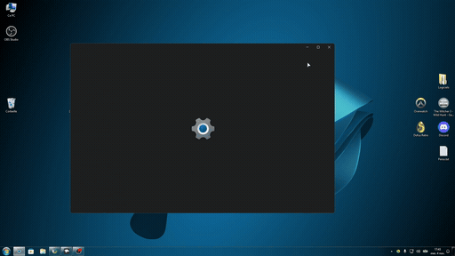
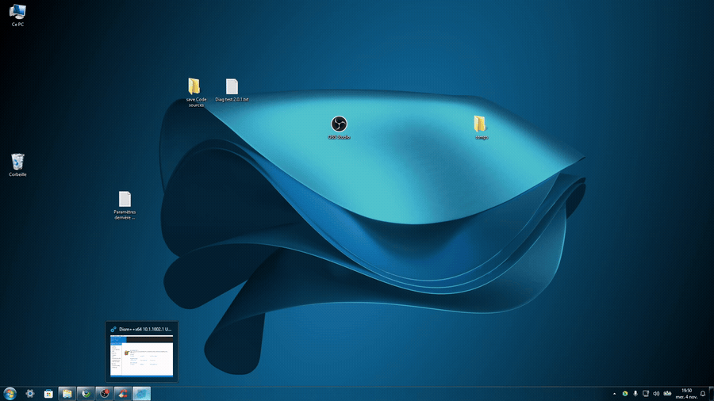

# Animation Windows edited By Origine

An independent edited version of **[Windows Animations](https://windhawk.net/mods/windows-animations)** by **[ReDrag](https://github.com/redrag2105)**.

**Version 1.6.21** · MIT license · Customized Genie/MSAA, Explorer acrylic handling and wider close-animation support.

> 🟢 **Compatibility:** Recommended for setups using **Translucent Windows, Windows 11 File Explorer Styler, and StartAllBack**. Behavior without these mods has not been verified.
>
> This is a community-edited build, **not an official update by ReDrag**. Do not run two different Windows Animations editions at the same time.

## Custom animation previews

Higher-resolution GIFs are shown **one per row** for better readability. The images will update once the new files have been uploaded to the `assets/` folder. The same previews are also referenced in the mod's **Details** page, above ReDrag's original gallery.

### Genie — dynamic taskbar button targeting

### File Explorer — acrylic Genie minimize and restore

### File Explorer — no residual background from another window

### Windows utilities — animated closing

### Hosted Windows applications — experimental closing

### More desktop software — closing animation showcase

## Improvements over the original mod

- Dynamic **MSAA taskbar-button targeting** prevents Genie from minimizing incompatible applications toward the far-left edge.
- Improved transparent Explorer captures reduce old-background or previous-window traces, including for maximized windows.
- A fast **75 ms Explorer restoration handoff** avoids unresolved acrylic artifacts from a full-length Genie restore.
- Closing animations work across all tested third-party applications on the original setup and many Windows utilities.
- Experimental hosted-window close support works on Settings, Calculator and Microsoft Store, with a slight remaining visual jump on some closes.
- Original `mmc.exe` exclusion is preserved to avoid instability in Services and Task Scheduler.

See [CHANGELOG.md](CHANGELOG.md) for the complete development summary and limitations.

## Installation

1. Install [Windhawk](https://windhawk.net/) and disable any other Windows Animations edition.
2. Download [windows-animations-edited-by-origine.wh.cpp](windows-animations-edited-by-origine.wh.cpp), create a new local mod and compile it.
3. **Your 26 tested personal parameters are already embedded as default values.** You can also import [settings/RECOMMENDED.json](settings/RECOMMENDED.json).
4. Keep **“Animate windows hidden to the tray”** enabled for extended close compatibility.

Not all processes are supported. Avoid testing important unsaved work without a backup. This source has not been independently compiled or runtime-validated for publication.

## Credits and license

- **[ReDrag](https://github.com/redrag2105)** — original Windows Animations developer, original engine, visual effects, documentation and GIF gallery.
- **[Abdullah Masood](https://github.com/Abdullah-Masood-05)** — classic Genie animation, as credited in ReDrag's original mod.
- **[Origine38](https://github.com/Origine38)** — edited edition, configuration and compatibility development.

The original code is distributed under the **MIT license**. The license and attribution for both the original project and this edited edition are preserved in [LICENSE](LICENSE). ReDrag's original donation options and original project credits remain in the mod's Details page.
